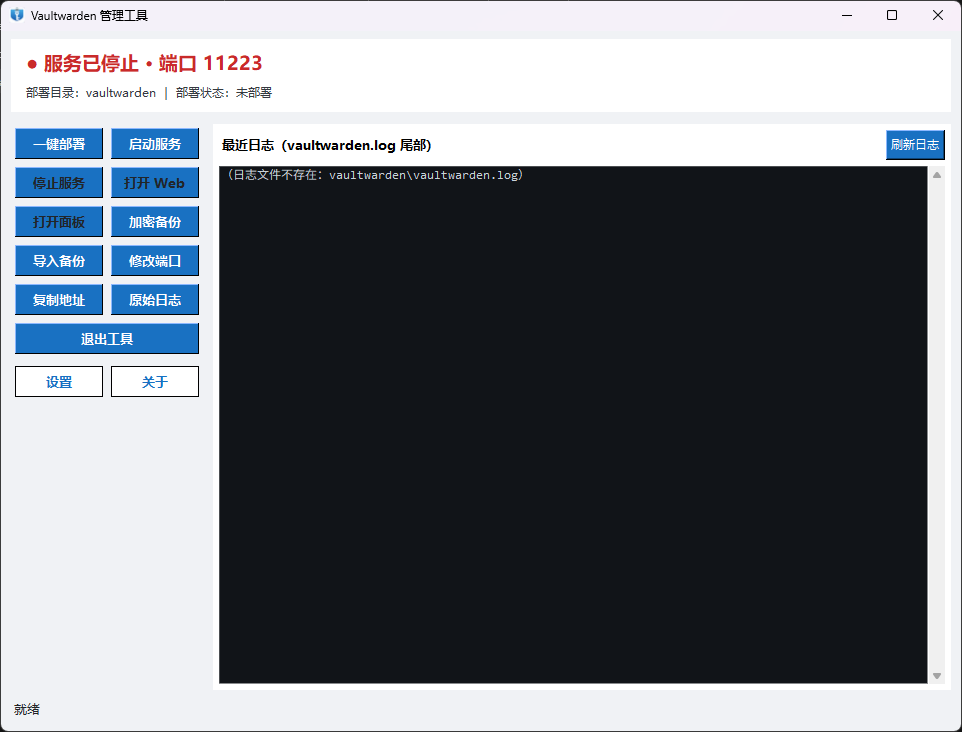

# Vaultwarden管理工具

> 自建 Vaultwarden 的 Windows 桌面管理工具｜版本 v1.9.11｜平台 Windows 10/11 x64｜作者 杨爽工作室｜制作工具 Marvis

VaultwardenManager 是一个用 Python + tkinter 编写的**单文件绿色工具**，把「自建 Vaultwarden 密码库服务」的
部署、启停、访问、备份、排障收拢到一个中文图形界面里。双击运行，不需要命令行，也不需要懂 Tomcat、
反向代理或证书链——第一次使用点「一键部署」，剩下的下载、证书、信任、管理口令全部自动完成。



> 截图位于 `assets/preview.png`，仓库内保留该占位路径；发布时可替换为最新界面截图。

## 目录

- [项目简介](#项目简介)
- [功能特性](#功能特性)
- [系统要求](#系统要求)
- [快速开始](#快速开始)
- [配置说明](#配置说明)
- [构建方法](#构建方法)
- [目录结构](#目录结构)
- [测试](#测试)
- [版本与更新](#版本与更新)
- [参与贡献](#参与贡献)
- [许可证](#许可证)
- [免责声明](#免责声明)

## 项目简介

[Vaultwarden](https://github.com/dani-garcia/vaultwarden) 是 Bitwarden 服务端的轻量实现，适合在个人电脑或
家庭服务器上自建密码库。它本身只提供 Windows 可执行文件，落地到一台普通 Windows 机器上仍需要若干步：
准备部署目录、写 `.env`、配 `ADMIN_TOKEN`、生成自签名证书、加入系统信任、安装 Web Vault 网页版、
记住端口与地址、定期备份 `data` 目录……

本项目把这些步骤界面化，形成「一个窗口 + 一组按钮」的使用方式，同时把容易出错的细节做了工程化处理：
端口不写死、地址按实际监听动态生成、进程按真实路径识别、备份加密并校验完整性、退出前先停服务、
托盘与单实例互斥避免重复启动。

适用人群：

- 在 Windows 上自建 Vaultwarden、希望少折腾配置的个人用户；
- 需要给家人/小团队维护一份内网密码库，但不熟悉服务端运维的同学；
- 想给自建服务加一层「备份 + 状态可视」的安全垫的用户。

## 功能特性

### 部署与运维

| # | 功能 | 说明 |
|---|---|---|
| 1 | 一键部署 | 自动下载 `vaultwarden.exe`（带进度条与大小校验）、自动安装 Web Vault 网页版、自动生成自签名证书、自动加入系统信任、自动生成 `ADMIN_TOKEN` 并提示保存 |
| 2 | 部署状态持久化 | 按磁盘实测判定「已部署 / 部分就绪 / 未部署」，部署完成后「一键部署」持久置灰，重启程序依然生效，避免重复下载覆盖 |
| 3 | 启动 / 停止服务 | 启动前同步 `.env` 端口与域名；停止按真实进程 PID 精确终止，含不在部署目录的残留同名实例 |
| 4 | 服务状态监控 | 区分「运行中 / 异常 / 非本目录实例 / 已停止」四态，状态栏配色提示，按钮矩阵随状态自动启用或禁用 |
| 5 | 系统托盘 | 最小化到托盘，托盘菜单可恢复窗口或退出；进程被强杀后自动清理残留托盘图标 |
| 6 | 单实例互斥 | 重复打开时弹出中文提示并激活已有窗口，托盘图标不重复堆积 |
| 7 | 安全退出 | 退出前自动停止服务，停止失败会二次确认；可记忆「下次不再询问」的退出方式（托盘或退出），按住 Shift 可强制恢复询问 |
| 8 | 服务状态记忆与自动恢复 | 退出时服务在运行，下次启动自动拉起服务；设置窗口可随时关闭该行为 |

### 访问与地址

| # | 功能 | 说明 |
|---|---|---|
| 9 | 打开 Web Vault | 按实际监听端口与实测协议（HTTP/HTTPS）生成地址打开，避免协议错配导致浏览器报网络链接错误 |
| 10 | 打开管理面板 | 在 Web Vault 地址后自动拼接 `admin_path`（默认 `/admin`） |
| 11 | 复制访问地址 | 复制当前可用地址到剪贴板，状态栏同步显示完整地址 |
| 12 | 浏览器插件连接指引 | 设置窗口展示本机地址与局域网地址（自动排除虚拟网卡），支持一键复制、打开地址信任证书、跳转 Edge/Chrome 扩展获取页 |

### 备份与恢复

| # | 功能 | 说明 |
|---|---|---|
| 13 | 一键加密备份 | 密码保护的全量 `data` 打包，可自选保存位置，文件名带时间戳与随机段防覆盖 |
| 14 | 导入备份 | 解密后还原，旧 `data` 先改名保留，失败自动回滚，不破坏现有数据 |
| 15 | 备份安全设计 | PBKDF2-HMAC-SHA256（600,000 次迭代 + 随机盐）、SHA-256 与 CRC 双重完整性校验、拒绝路径穿越与符号链接、限制条目数/解压总量/压缩比、密码不落盘、弱密码拦截 |

### 网络与端口

| # | 功能 | 说明 |
|---|---|---|
| 16 | 修改端口 | 弹窗校验 1–65535，同步更新程序配置与服务端 `.env` 的端口与域名 |
| 17 | 端口占用自动切换 | 部署或启动前检测端口，被其它程序占用时自动挑选空闲端口并双端同步，单次流程最多切换一次 |
| 18 | 局域网 IP 智能识别 | 解析网卡名称、描述与默认网关，排除 Hyper-V / VMware / WSL 等虚拟网卡，按私网网段与出口一致性打分取首选 |
| 19 | 端口单一配置源 | 端口默认值只存在于一处，界面地址、链接、部署与 `.env` 同步全链路运行时读取，不会出现配置漂移 |

### 日志与审计

| # | 功能 | 说明 |
|---|---|---|
| 20 | 日志实时查看 | 可配置尾部行数（默认 300 行），定时刷新 |
| 21 | 噪音过滤 | 按关键词过滤 TLS handshake、HSTS 等噪音，并可切换回原始日志 |
| 22 | 日志自动轮转 | 超过设定体积（默认 10 MB）自动归档为新文件，避免日志无限增长 |
| 23 | 操作留痕 | 部署、启停、备份、改端口、自动恢复等操作写入 `manager.log`，可回溯 |

### 配置与界面

| # | 功能 | 说明 |
|---|---|---|
| 24 | 配置自动兜底 | 配置文件缺失或损坏自动重建默认值，缺字段自动补齐，不抛异常 |
| 25 | 便携式部署目录 | 程序在哪，部署就在哪；检测到旧固定路径配置时自动迁移并保留原目录 |
| 26 | 设置窗口 | 退出记忆、部署下载地址、浏览器插件连接、当前信息四个分区，可滚动查看 |
| 27 | 关于窗口 | 版本、作者/版权、简要说明与内置赞助二维码（点击可放大） |
| 28 | 统一图标 | 程序文件、窗口、系统托盘使用同一套「盾牌 + 锁」图标，小尺寸单独简化绘制 |
| 29 | 全中文高对比界面 | 统一按钮配色、加深文字对比度、禁用态文字清晰可读，日志区深底浅字 |
| 30 | 非阻塞架构 | 状态探测、部署、备份、退出停服均在后台线程执行，界面不卡顿（状态探测耗时约 4 秒降至约 0.13 秒） |
| 31 | 可调轮询间隔 | `status_check_ms` 控制状态刷新频率，兼顾实时性与资源占用 |
| 32 | 路径全部可配 | 部署目录、证书目录、备份目录、日志文件名等均可在配置中修改 |
| 33 | 零外部依赖污染 | 依赖只有 `cryptography` / `pystray` / `pillow`，无数据库、无 Web 框架、无需管理员权限运行 |

## 系统要求

| 项目 | 要求 |
|---|---|
| 操作系统 | Windows 10 / 11（x64），已在 Windows 11 Build 26200 实测 |
| 运行方式 | 下载 `VaultwardenManager.exe` 直接运行（无需安装 Python） |
| 源码运行 | Python 3.11 及以上，标准库自带 tkinter |
| 磁盘 | 程序本体约 23 MB；完整部署（含 exe 与网页版）约 200 MB 以上 |
| 网络 | 首次一键部署需访问 GitHub 下载 `vaultwarden.exe` 与 Web Vault 网页版，需能访问对应地址 |
| 权限 | 以当前用户权限运行即可；自签名证书加入的是「当前用户」信任存储，无需管理员 |
| 路径 | 程序与部署目录建议使用不含中文、不含空格的路径 |

## 快速开始

### 方式一：使用发布包（推荐普通用户）

1. 从仓库 Releases 页面下载最新的 `VaultwardenManager.exe`（若尚未发布，可用下方「方式二」自行构建）。
2. 新建一个空目录（例如 `D:\Vaultwarden`），把 exe 放进去——部署目录会随之生成在该目录下。
3. 双击运行，点击「一键部署」，等待进度条完成。部署过程会自动完成下表中所有操作。

   | 步骤 | 自动行为 |
   |---|---|
   | 1 | 下载 `vaultwarden.exe`（大小校验，失败清理半成品） |
   | 2 | 下载并解压 Web Vault 网页版到 `web-vault\` |
   | 3 | 生成自签名证书到 `ssl\cert.pem` / `ssl\key.pem` |
   | 4 | 把证书加入当前用户「受信任的根证书颁发机构」 |
   | 5 | 生成随机 `ADMIN_TOKEN` 写入 `.env`，并在界面提示一次 |
   | 6 | 同步 `.env` 的端口与域名后启动服务 |

4. 点击「打开 Web」访问网页版，或「打开面板」进入管理界面；创建账号后即可用
   [Bitwarden 浏览器扩展](https://bitwarden.com/download/)登录（服务器地址填设置窗口里显示的地址）。
5. 建议立刻点击「加密备份」，用密码保护的形式把 `data` 目录备份一份到安全位置。

### 方式二：源码运行（开发者）

```powershell
git clone <你的仓库地址> vaultwarden-manager
cd vaultwarden-manager
pip install -r requirements.txt
python vaultwarden_manager.py
```

首次运行会在脚本目录自动生成 `config.json`；如需自定义配置，参考下一节。

## 配置说明

程序启动时若 `config.json` 缺失或损坏，会自动按默认值重建，**不会报错**。仓库只提供脱敏后的示例
[`config.example.json`](config.example.json)，其中不含任何本机绝对路径与个人数据。

```powershell
# 从示例创建本地配置（按需修改后再启动程序）
Copy-Item config.example.json config.json
```

`config.json` 与程序同目录（打包后为 exe 所在目录）。主要字段：

| 字段 | 示例值 | 说明 |
|---|---|---|
| `vaultwarden_dir` | `vaultwarden` | 部署目录。示例使用相对路径（相对程序目录），也可填绝对路径 |
| `exe_name` | `vaultwarden.exe` | 服务主程序名 |
| `port` | `44444` | 服务端口，唯一权威配置源，界面与 `.env` 均以此为准 |
| `ssl_dir` | `vaultwarden/ssl` | 证书目录 |
| `cert_file` / `key_file` | `cert.pem` / `key.pem` | 证书与私钥文件名 |
| `backup_dir` | `vaultwarden/backup` | 备份存放目录 |
| `log_file` / `err_log_file` | `vaultwarden.log` / `vaultwarden.err.log` | 日志文件名（位于部署目录） |
| `log_lines` | `300` | 日志区显示尾部行数 |
| `log_max_mb` | `10` | 日志轮转阈值（MB） |
| `log_noise_keywords` | `["tls handshake", "HSTS"]` | 日志噪音过滤关键词（大小写不敏感） |
| `vw_download_url` | GitHub 下载地址 | 一键部署时 `vaultwarden.exe` 的下载地址，留空则提示中止 |
| `vw_download_timeout` | `120` | 下载超时（秒） |
| `vw_webvault_download_url` | GitHub 下载地址 | Web Vault 网页版 `.tar.gz` 下载地址，留空则跳过网页版安装 |
| `vw_webvault_download_timeout` | `180` | 网页版下载超时（秒） |
| `status_check_ms` | `3000` | 状态轮询间隔（毫秒） |
| `cert_days` | `3650` | 自签名证书有效期（天） |
| `domain` | `https://localhost:44444` | 默认访问域名，改端口时自动跟随 |
| `admin_path` | `/admin` | 管理面板路径 |
| `quit_confirm_skip` | `false` | 是否跳过退出确认（可在设置窗口图形化配置） |
| `quit_default_action` | `tray` | 记忆的退出动作：`tray` 最小化到托盘 / `quit` 退出 |
| `last_exit_service_running` | `false` | 运行态字段：退出时服务是否在运行（自动维护） |
| `auto_restore_service` | `true` | 下次启动是否自动恢复服务 |
| `ext_edge_url` / `ext_chrome_url` | 商店搜索页 | 「获取扩展」按钮打开的地址 |

几点说明：

- **相对路径**以程序所在目录为基准，示例中的 `vaultwarden` / `vaultwarden/ssl` 会在程序目录下展开，
  便于在不同机器间复制整个文件夹。
- `last_exit_service_running` 属于运行态字段，示例中置为默认值，实际由程序在退出时自动维护。
- 完整字段语义与历史演进见 [DEV.md](DEV.md) 第 5 节。

## 构建方法

```powershell
cd <项目根目录>
pip install pyinstaller cryptography
python -m PyInstaller -F -w --noconfirm --clean --icon=assets\app.ico --add-data "assets;assets" --exclude-module numpy --exclude-module numpy.libs --exclude-module yaml --exclude-module bcrypt --exclude-module scipy --exclude-module pandas --exclude-module matplotlib --exclude-module PyQt5 --exclude-module PySide6 --name VaultwardenManager vaultwarden_manager.py
```

- `-F` 单文件、`-w` 无控制台窗口、`--icon` 与 `--add-data` 保证图标资源可用。
- `--exclude-module` 列表必须带全：这些模块项目代码零引用，但会被环境中的打包钩子连带收集，
  漏掉后 exe 体积约 34 MB，带全后约 22.4 MB。
- 产物：`dist\VaultwardenManager.exe`。完整的打包后功能回归清单见 [DEV.md](DEV.md) 第 6 节。

## 目录结构

```
vaultwarden-manager\
├─ vaultwarden_manager.py      # 入口：薄转发壳，from vwm.app import main
├─ vwm\                        # 主程序包
│  ├─ app.py                   # GUI 主窗口、按钮矩阵、托盘、单实例、自动恢复
│  ├─ ui.py                    # 弹窗（设置/关于/退出确认）与 UI 配色常量、VERSION
│  ├─ config.py                # 配置读写、默认值、旧路径迁移、端口同步
│  ├─ service.py               # 启停、状态探测、端口占用切换、ADMIN_TOKEN
│  ├─ deploy.py                # 一键部署全链路、下载、网页版解压
│  ├─ backup.py                # 加密备份、导入恢复、恶意备份防护
│  ├─ cert.py                  # 自签名证书生成、系统信任
│  ├─ logs.py                  # 日志轮转、读取、噪音过滤、操作留痕
│  ├─ network.py               # 地址解析、端口探测、局域网 IP 识别
│  └─ common.py                # 共享常量与工具
├─ assets\                     # 图标资源（app.ico / app*.png / tray.png / sponsor_qr.png / preview.png）
├─ tests\                      # 回归脚本 verify_<主题>_v<版本>.py
├─ config.example.json         # 配置示例（脱敏）
├─ requirements.txt            # cryptography / pystray / pillow
├─ README.md                   # 本文件
├─ CHANGELOG.md                # 面向用户的版本变更
├─ CONTRIBUTING.md             # 开发与提交约定
├─ SECURITY.md                 # 安全说明与漏洞反馈
├─ LICENSE                     # MIT
└─ DEV.md                      # 开发手册（架构、模块、配置、打包、版本记录）
```

运行期在程序目录下会自动生成 `config.json` 与 `vaultwarden\` 部署目录（`.env`、`data\`、`ssl\`、
`web-vault\`、日志、`backup\`），这些内容**均在 `.gitignore` 中排除**，不会被提交。

## 测试

`tests\` 下为按版本沉淀的回归脚本，直接运行即可（输出含 PASS/FAIL 计数）：

```powershell
python tests\verify_port_guard_v198.py     # 端口占用自动切换
python tests\verify_restore_v198.py        # 服务状态记忆与自动恢复
python tests\verify_backup_v195.py         # 加密备份格式与恶意备份防护
python tests\verify_deploy_lock_v194.py    # 一键部署持久禁用
python tests\verify_about_sponsor_v1911.py # 关于窗口与赞助区
python tests\verify_single_instance_v193.py# 单实例互斥
python tests\verify_ghost_v192.py          # 托盘残留图标清理
python tests\verify_quit_v192.py           # 退出链路清理
```

提交前的完整自检流程（含语法编译检查与打包回归清单）见 [CONTRIBUTING.md](CONTRIBUTING.md) 第 6 节。

## 版本与更新

- 当前版本：**v1.9.11**（见「关于」窗口或 `vwm/ui.py` 的 `VERSION`）。
- 面向用户的变更记录：[CHANGELOG.md](CHANGELOG.md)。
- 完整开发记录、模块说明与版本演进：[DEV.md](DEV.md)。

## 参与贡献

欢迎提交 issue 与 Pull Request。开始前请阅读 [CONTRIBUTING.md](CONTRIBUTING.md)（开发环境、自检方式、
全中文文案约定、禁止提交的文件清单）。安全问题请按 [SECURITY.md](SECURITY.md) 私下反馈。

## 许可证

本项目使用 [MIT License](LICENSE) 发布。

Copyright (c) 2026 杨爽工作室 (Yang Shuang Studio)

## 免责声明

- 本项目是**第三方辅助工具**，与 Vaultwarden、Bitwarden 官方项目无关联、未获其背书；相关名称与商标
  归各自所有者。
- 自签名证书、端口暴露、内网访问等配置的安全性由使用者自行评估；**不建议**把本工具部署的服务直接
  暴露到公网，如需外网访问请自行叠加反向代理、TLS 证书、访问控制与防火墙策略。
- 密码库数据安全由使用者自负。请务必：使用强口令、定期执行加密备份、把备份保存在与主机分离的位置、
  并**实际验证过一次恢复流程**。
- 「一键部署」会从配置中的地址下载第三方二进制文件，请自行确认来源可信；网络异常、磁盘空间不足、
  权限受限等外部原因造成的失败，本项目不承担连带责任。
- 本软件按「现状」提供，不附带任何明示或暗示担保；因使用本软件导致的数据丢失、服务中断或其它损失，
  作者不承担责任。
- 本项目不接受「代为运维他人密码库」的委托，也不提供任何形式的商业支持承诺。
